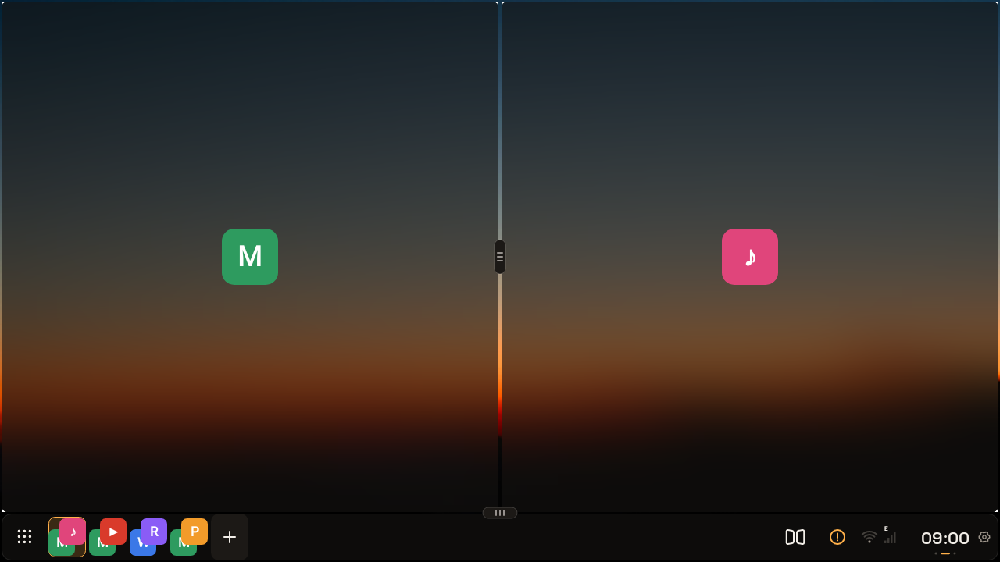
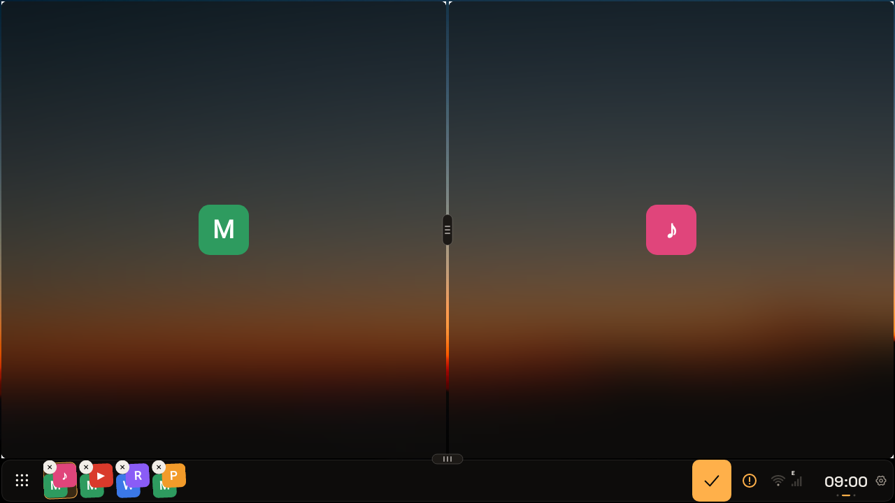
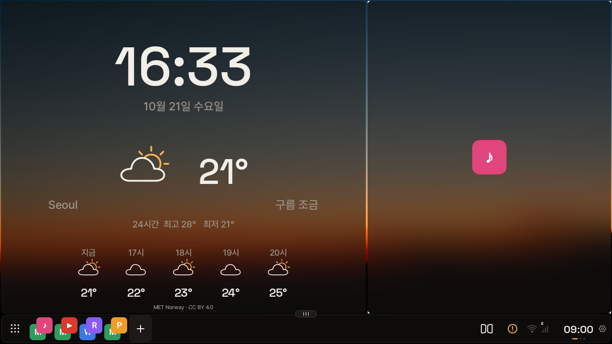

# DUO Launcher · AI Box updates

Carlinkit 및 호환 AI Box를 위한 테스트 APK와 서명된 업데이트 정보입니다. 앱 소스 코드는 포함하지 않습니다.

최신 버전: **1.6.3** · [AI Box APK 다운로드](https://github.com/byezzun/duo-launcher-updates/releases/download/v1.6.3/duo-launcher-aibox-1.6.3.apk). 1.6.1~1.6.2의 키보드 문제(앱 뒤로 숨거나 크기가 바뀜) 수정, 핸들 리모컨 다음 곡·이전 곡 전달, 앱 영역에 기본 런처(Quickstep)가 끼어들지 않도록 보완했습니다. 1.5.x에서 업데이트할 때 설치 권한을 허용한 뒤 DUO로 돌아와 ‘업데이트 확인’을 다시 눌러 주세요. 엠비언트 6225 Quickstep 문제는 실기기 해결 확인 전입니다.

## 화면 / Screenshots

| 두 앱 나란히 / Two apps side by side | 독 즐겨찾기 편집 / Editing dock favorites |
| --- | --- |
|  |  |

DUO의 실제 화면 코드를 PC에서 그린 이미지입니다. 차량에서는 각 영역에 실제 앱 화면이 나오며, 여기서는 예시 앱 아이콘으로 표시했습니다. 독의 ⓘ 경고 표시는 PC 환경에 시스템 권한이 없어서 보입니다.
Rendered on a PC from DUO's real UI code. On the AI Box each pane shows the running app; sample app icons stand in here. The warning badge in the dock appears only because the PC renderer has no system permissions.

## 설치

Releases의 AI Box APK를 내려받아 기존 AI Box 버전 위에 업데이트합니다. 기존 앱을 먼저 삭제하지 마세요. 처음 설치한 경우 Android 설정에서 기본 홈으로 선택합니다.

1.4.2에는 OTA가 없으므로 최신 APK를 직접 설치해야 합니다. 구버전 OTA에서 오류가 나도 최신 APK를 직접 받아 기존 앱 위에 업데이트할 수 있습니다. 1.5.0부터 설정 → 업데이트 확인을 통해 이후 버전을 확인할 수 있습니다. 다운로드 및 Android 설치 확인은 사용자가 직접 선택합니다.

## 호환성

필요한 시스템 권한과 기기 펌웨어가 맞아야 내부 앱 실행이 가능합니다. 모든 Carlinkit·AI Box 모델을 검증한 것은 아니며 일반 휴대폰용 버전이 아닙니다. 태블릿 화면 유지와 실제 업데이트 설치·설정 보존은 기기별 확인이 필요합니다. 앱 서명이나 업데이트 기능이 없는 시스템 권한을 부여하지는 않습니다.

## English

Test builds for compatible Carlinkit and Android AI Boxes. Download the AI Box APK from Releases and update your existing installation. Do not uninstall first. Version 1.4.2 has no OTA client. Install the latest APK manually; use the same method if OTA fails on an older build. Later versions can be checked in Settings → Check for updates. Downloads and Android installation require your confirmation.

Required system privileges and firmware compatibility still apply. This is not a general phone build. Support for every AI Box, tablet layouts, DRM playback, and real-device update installation is not guaranteed. This repository contains distribution files and update metadata only.
