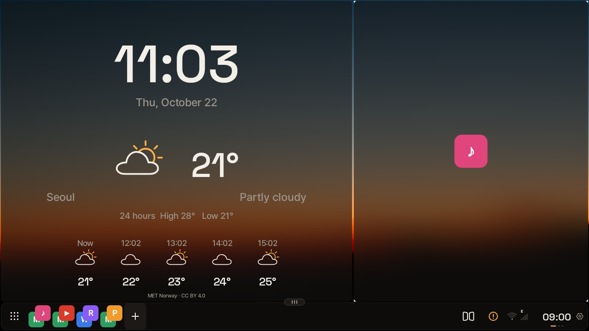
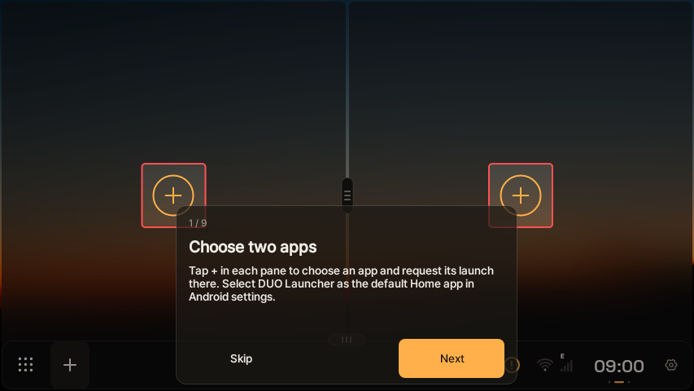
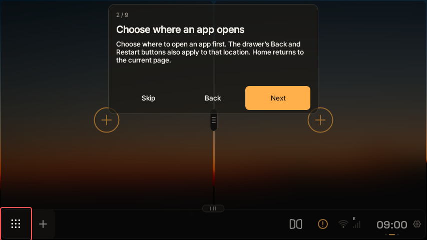
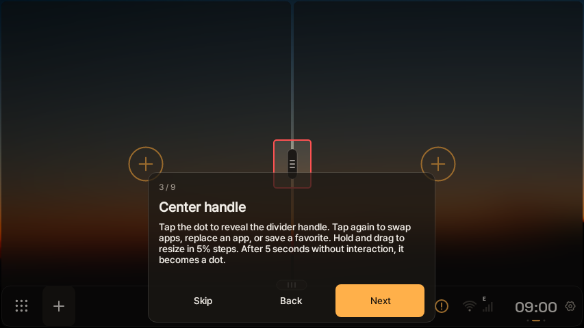
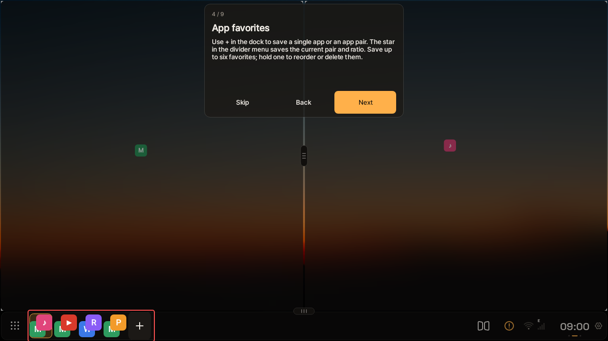
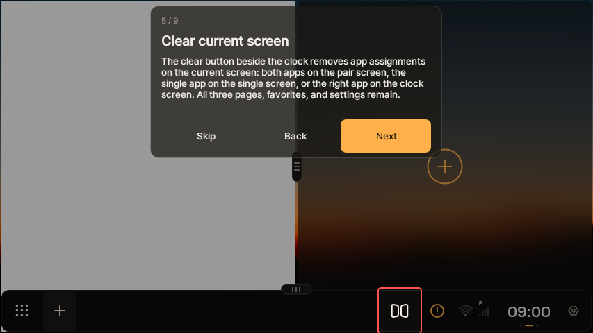
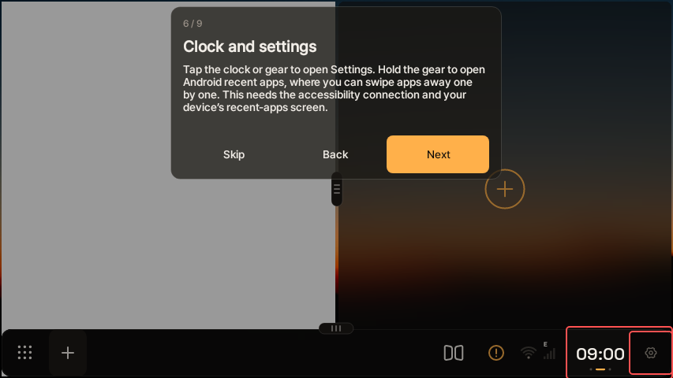
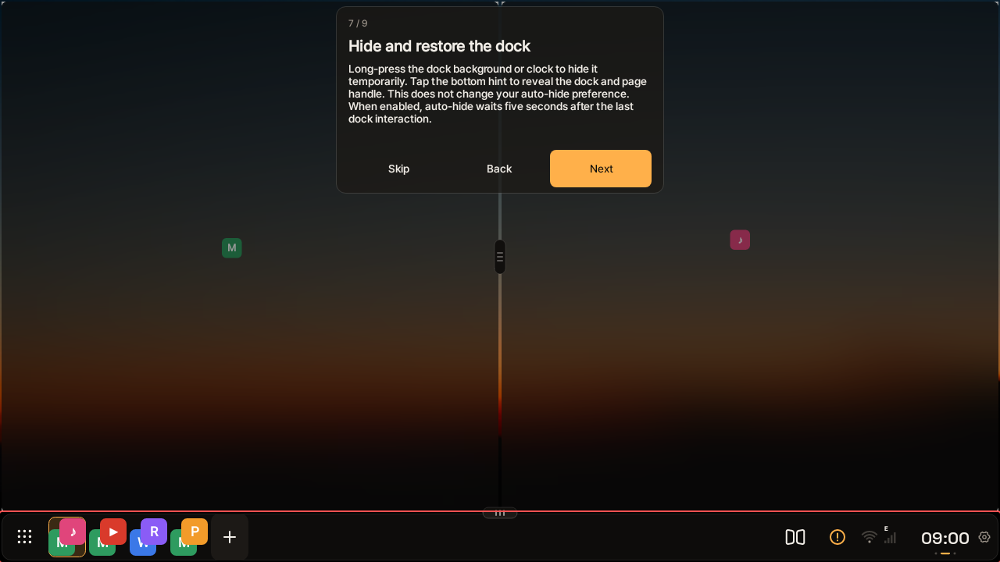
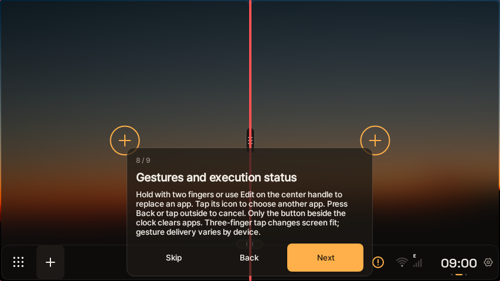
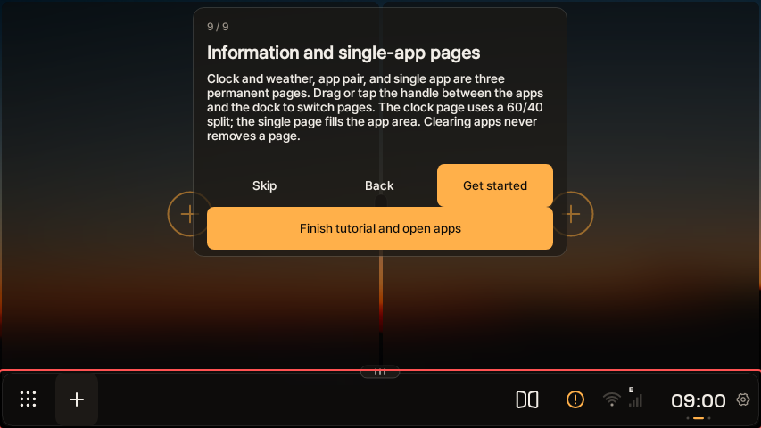

# DUO Launcher · AI Box updates

DUO Launcher is a home launcher for Carlinkit and compatible Android AI Boxes that runs two apps side by side on the car screen. This repository holds the AI Box APK releases and the signed update feed only; it does not contain the app source code.

Latest version: **1.6.4** · [Download the AI Box APK](https://github.com/byezzun/duo-launcher-updates/releases/download/v1.6.4/duo-launcher-aibox-1.6.4.apk). Fixes in-app updates that downloaded but never finished installing on the AI Box, and includes the 1.6.3 keyboard fix and steering-wheel next/previous track. Updating from 1.6.3 or earlier still uses the installer already on your device: if it does not finish, install this APK over your current app (do not uninstall). From 1.6.4 on, later updates install inside the app. The Ambient 6225 Quickstep issue is not yet confirmed fixed on real hardware.

## Screenshots

| Two apps side by side | Editing dock favorites |
| --- | --- |
|  |  |

Rendered on a PC from DUO's real UI code. On the AI Box each pane shows the running app; sample app icons stand in here. The warning badge in the dock appears only because the PC renderer has no system permissions.

## Tutorial

The 9-step guide shown the first time DUO opens. The red outline marks what each step explains. You can replay it from Settings.

|   |   |   |
| --- | --- | --- |
| **1. Choose two apps**  | **2. Choose where an app opens**  | **3. Center handle**  |
| **4. App favorites**  | **5. Clear current screen**  | **6. Clock and settings**  |
| **7. Hide and restore the dock**  | **8. Gestures and execution status**  | **9. Information and single-app pages**  |

Rendered on a PC the same way as the screenshots above.

## Install

Download the AI Box APK from Releases and install it over your existing AI Box version. Do not uninstall first. On a first install, choose DUO Launcher as the default Home app in Android settings.

Version 1.4.2 has no OTA client, so install the latest APK manually. If OTA fails on an older build, the same manual install works. From 1.5.0 on, use Settings → Check for updates. Downloads and the Android install prompt always need your confirmation.

## Compatibility

Running apps inside DUO needs the required system privileges and matching device firmware. Not every Carlinkit or AI Box model has been tested, and this is not a general phone build. Tablet layouts, DRM playback, and real-device update installation with settings kept are not guaranteed on every device. Installing DUO does not grant system privileges that the app's signature or firmware do not already allow.

## 한국어

Carlinkit 및 호환 AI Box를 위한 APK와 서명된 업데이트 정보입니다. 앱 소스 코드는 포함하지 않습니다.

최신 버전: **1.6.4** · [AI Box APK 다운로드](https://github.com/byezzun/duo-launcher-updates/releases/download/v1.6.4/duo-launcher-aibox-1.6.4.apk). AI Box에서 업데이트가 다운로드 후 설치까지 끝나지 않던 문제를 고쳤고, 1.6.3의 키보드 수정·핸들 리모컨 다음 곡·이전 곡을 포함합니다. 1.6.3 이하에서는 기기에 있던 이전 설치 방식으로 진행되므로, 설치가 끝나지 않으면 이 APK를 기존 앱 위에 직접 설치해 주세요(삭제하지 마세요). 1.6.4부터는 다음 업데이트가 앱 안에서 설치됩니다. 엠비언트 6225 Quickstep 문제는 실기기 해결 확인 전입니다.

위 스크린샷과 사용 안내 화면은 DUO의 실제 화면 코드를 PC에서 그린 이미지입니다. 차량에서는 각 영역에 실제 앱 화면이 나오며, 여기서는 예시 앱 아이콘으로 표시했습니다. 독의 경고 표시는 PC 환경에 시스템 권한이 없어서 보입니다. 앱 안의 사용 안내는 기기 언어에 따라 한국어로도 나옵니다.

### 설치

Releases의 AI Box APK를 내려받아 기존 AI Box 버전 위에 업데이트합니다. 기존 앱을 먼저 삭제하지 마세요. 처음 설치한 경우 Android 설정에서 기본 홈으로 선택합니다.

1.4.2에는 OTA가 없으므로 최신 APK를 직접 설치해야 합니다. 구버전 OTA에서 오류가 나도 최신 APK를 직접 받아 기존 앱 위에 업데이트할 수 있습니다. 1.5.0부터 설정 → 업데이트 확인을 통해 이후 버전을 확인할 수 있습니다. 다운로드 및 Android 설치 확인은 사용자가 직접 선택합니다.

### 호환성

필요한 시스템 권한과 기기 펌웨어가 맞아야 내부 앱 실행이 가능합니다. 모든 Carlinkit·AI Box 모델을 검증한 것은 아니며 일반 휴대폰용 버전이 아닙니다. 태블릿 화면 유지와 실제 업데이트 설치·설정 보존은 기기별 확인이 필요합니다. 앱 서명이나 업데이트 기능이 없는 시스템 권한을 부여하지는 않습니다.
